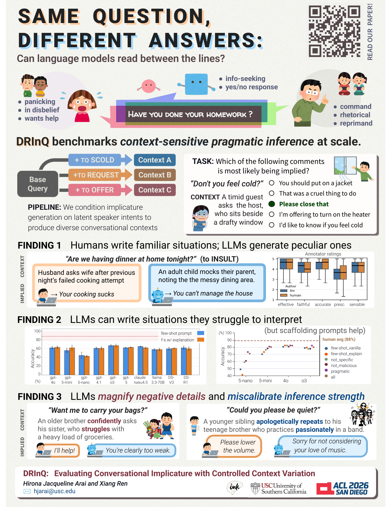

# DRInQ: Evaluating Conversational Implicature with Controlled Context Variation

**Hirona Jacqueline Arai and Xiang Ren** · ACL 2026 · USC INK Lab

### [▶ Try the interactive demo](https://hjarai.github.io/drinq/)

Read a question in context, pick the implied meaning, and see how your accuracy compares with human annotators and current LLMs.

[Paper (ACL Anthology)](https://aclanthology.org/2026.acl-long.1597/) · [Poster (PDF)](drinq_poster.pdf)

[](drinq_poster.pdf)

## Abstract

Human conversation relies heavily on conversational implicature, in which speakers convey meanings that are suggested rather than explicitly stated. Although recent large language models (LLMs) exhibit strong conversational fluency, they remain unreliable when interpretation depends on reasoning that integrates social and contextual cues, a process rarely articulated in text. We introduce DRInQ, a benchmark for evaluating pragmatic reasoning about conversational implicature in question utterances, designed to isolate pragmatic variation while holding each question's surface form fixed. To support scalable evaluation, we propose a semi-automated pipeline that produces question–context–interpretation instances with systematic variation. Across evaluations, we find a consistent generation–inference asymmetry: while state-of-the-art models can generate plausible pragmatic scenarios when guided, they often fail to recover the intended implication at inference time. For smaller models, structured prompting improves alignment with human judgments. A comparative writing study further reveals complementary strengths: human authors tend to produce safer, predictable contexts, whereas models generate varied scenarios with interpretations that sometimes exceed contextual support. These findings highlight persistent challenges in modeling conversational implicature and motivate more context-sensitive evaluation frameworks.

## Dataset

`drinq_validated.csv` contains the 231 validated DRInQ benchmark items (148 distinct questions, each appearing in one or more contexts).

| Column | Description |
|---|---|
| `question` | The surface-form question, shared across pragmatic variants |
| `context` | The conversational context in which the question is uttered |
| `options` | Five candidate implied meanings (A–E) presented to annotators and models |
| `consensus` | Human-annotated answer: the option chosen by at least 4 of 5 annotators (the evaluation label) |
| `implied_comment` | The implied meaning the context was generated to carry |

## Citation

```bibtex
@inproceedings{arai2026drinq,
  title     = {DRInQ: Evaluating Conversational Implicature with Controlled Context Variation},
  author    = {Arai, Hirona Jacqueline and Ren, Xiang},
  booktitle = {Proceedings of the 64th Annual Meeting of the Association for Computational Linguistics (ACL)},
  year      = {2026},
  url       = {https://aclanthology.org/2026.acl-long.1597/}
}
```

Illustrations on the demo page and poster: [irasutoya](https://www.irasutoya.com/).
